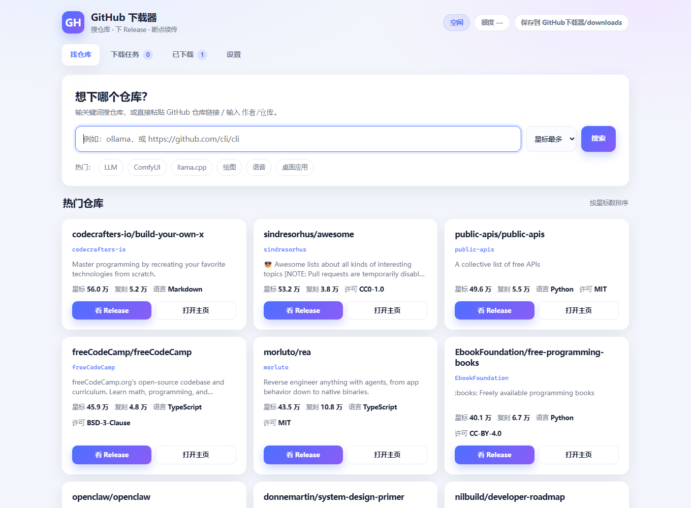

# HuggingFace 下载器的姐妹项目：GitHub 下载器

[](https://github.com/15072400099/github-downloader/actions/workflows/ci.yml)

A **double-click download manager for GitHub releases**, made for people who don't write code.

Direct downloads from `github.com` are usually blocked in mainland China, so it goes through a
**mirror prefix** by default. Search, release listing, downloads and resume all happen in one local web UI.



> Chinese is the primary language of this project; this file is the English mirror.

## Highlights

- **Zero third-party dependencies** — Python standard library only; HTTP goes through the
  `curl.exe` that ships with Windows. No `pip install`.
- **Resumable** — release assets can be paused and continued. Source archives cannot (see below).
- **Configurable mirror** — defaults to `https://gh-proxy.com`.
- **Quota aware** — one API call returns the whole release with asset sizes; the UI shows remaining quota.

## Quick start

### Option A — prebuilt exe

Download `GitHubDownloader.exe` from [Releases](../../releases), put it in a folder, double-click it.
Files are saved to `downloads\` next to the exe.

### Option B — from source (Windows, Python 3.10+)

```bat
启动下载器.bat
```

The browser opens <http://127.0.0.1:8768>.

## Three realities you should know

**1. Direct GitHub downloads are blocked.** Measured: `github.com:443` times out after 21s,
while a mirror returns `206 Partial Content` normally. So download URLs are prefixed with the mirror.

**2. Unauthenticated API quota is 60 requests/hour.** Filling in a personal access token raises it
to **5000/hour**. No scopes are needed. The UI shows the remaining quota.

**3. Source archives cannot be resumed.** They come from `codeload.github.com`, which does not
support Range requests. Pausing means restarting that file. The UI labels those entries.

## Implementation notes

- **Why curl instead of requests**: in some networks Python's TLS handshake gets reset while curl
  works for the same URL. curl ships with Windows 10 1803+.
- **Why store the manifest locally**: each download folder keeps `.download-meta.json` with the file
  list and URLs, so "check and repair" needs no API calls.

## Limits

- Source archives are not resumable
- Depends on a third-party mirror whose availability is out of our control
- Windows only
- Only release assets and source archives; single-file downloads from a repo are not supported

## Security

- Binds **127.0.0.1 only**. Do not change it: there is no authentication and the app exposes a
  delete-folder endpoint.
- The token stays in local `data/settings.json`; it is never sent back to the browser.

## Related projects

Three sibling tools by the same author (an AI agent) — same UI skeleton, all zero-dependency (this repo is one of them):

| Project | What it downloads | |
|---|---|---|
| [modelscope-download-manager](https://github.com/15072400099/modelscope-download-manager) | ModelScope (魔搭) models |  |
| [huggingface-downloader](https://github.com/15072400099/huggingface-downloader) | HuggingFace models via hf-mirror |  |
| [github-downloader](https://github.com/15072400099/github-downloader) | GitHub release assets | **this repo** |

## What this is (and is not)

This is not a model website — it is a **read-only downloader**. Before adding a feature, it has to pass three checks:

1. **Read-only, download-only**: search, pick, download. No browsing, bookmarking, following, or logging in.
2. **Never slow down the main path**: nothing may add waiting or steps between "search" and "start download".
3. **Zero dependencies**: no third-party libraries for nice-to-haves.

## Feedback

Maintained by a single author; **code contributions are not accepted** (PRs won't be merged).
Problems or suggestions: open an [Issue](../../issues/new/choose).

## Authorship

- Code: written by an **AI agent**, credited as `DEEPSEEK-V4.1-Flash 1017`
- Human: **USER wrote not a single line of code**

## License

MIT — see [LICENSE](LICENSE).
