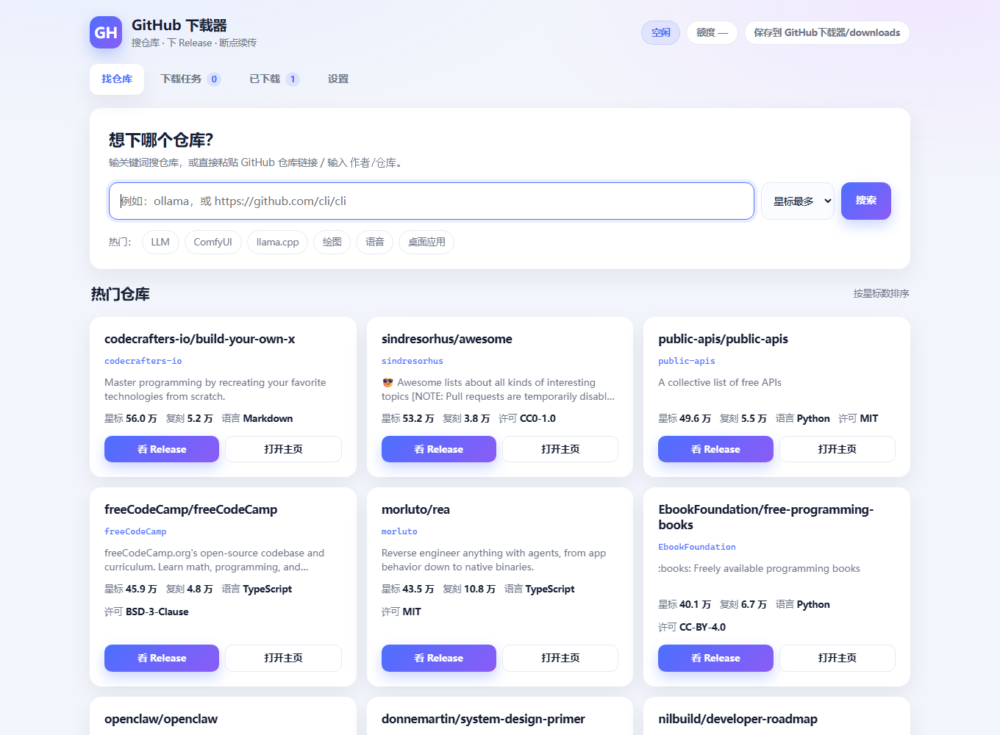

# GitHub 下载器

[](https://github.com/15072400099/github-downloader/actions/workflows/ci.yml)

给不写代码的人用的 **GitHub 下载器**：双击即用，搜仓库、挑 Release、点着下。

国内直连 `github.com` 的下载地址基本不通，这个工具默认套一层**加速镜像**，
下载、断点续传、暂停继续都在一个网页界面里完成。



## 特点

- **零第三方依赖**：只用 Python 标准库，传输层用 Windows 自带的 `curl.exe`
- **断点续传**：Release 资源暂停/关程序后能接着下（源码压缩包除外，见下）
- **镜像池 + 自动测速**：多个镜像自动选最快的，挂了会换；代理是可选的兜底开关
- **省额度**：一次请求就拿回整个 Release 的资源清单和大小，界面实时显示剩余调用次数
- **看得清**：进度、速度、剩余时间，还能只挑 Windows 版资源

## 快速开始

### 方式一：免安装 exe

从 [Releases](../../releases) 下载 `GitHubDownloader.exe`，放到任意文件夹双击即可。
文件存在 exe 旁边的 `downloads` 目录。

### 方式二：源码运行（Windows + Python 3.10+）

```bat
启动下载器.bat
```

不需要 `pip install` 任何东西。浏览器自动打开 <http://127.0.0.1:8768>。

> 黑窗口就是程序本体，关掉它就停了。用完双击 `关闭下载器.bat` 更干净。

### 批处理

| 文件 | 作用 |
|---|---|
| `启动下载器.bat` | 启动（重复双击不会多开） |
| `关闭下载器.bat` | 停服务、清残留进程、关掉多余窗口 |
| `检查并补齐现有文件.bat` | 按本地记录核对文件，缺的补下来 |
| `安装环境.bat` | 可选：自检 Python 与 curl |

## 三个必须知道的现实

### 1. 直连 GitHub 下载不通，所以要靠镜像；镜像会自动挑最快的

实测本机 `github.com:443` 超时（21 秒无响应），而加速镜像返回 `206 Partial Content` 正常。
所以下载地址会套一层镜像前缀：`<镜像>/<原始地址>`。

程序启动后会在后台给**镜像池**测速，自动选最快的那个：

```
https://ghfast.top        184 KB/s   ← 选中
https://gh-proxy.com      116 KB/s
https://gh-proxy.net      不可用
```

- 镜像列表可以在设置页改（一行一个），点「测速」随时重新比
- 某个镜像挂了会自动换下一个
- **代理默认关闭**：镜像是免费的，代理是花钱买速度，需要时在设置里开

实测差距：无代理约 180 KB/s，挂上代理能到 5.8 MB/s。所以代理留作兜底，不是必需品。

### 2. 未登录接口只有 60 次/小时

GitHub 对未认证请求的限制非常紧，浏览几个仓库就见底。填一个 token 提到 **5000 次/小时**：

> GitHub → Settings → Developer settings → Personal access tokens → Generate new token，
> **一个权限都不用勾**，复制 `ghp_…` 填进设置页即可。

### 3. 源码压缩包不能续传

GitHub 的源码包走 `codeload.github.com`，**不支持 Range 请求**，所以暂停后只能整份重下。
界面里这类资源会标注「源码包，不支持续传」。Release 里的二进制资源没有这个问题。

## 实现说明

**为什么用 curl 而不是 requests？**
部分网络环境下 Python 的 TLS 握手会被对端重置，而 curl 对同一地址正常。
这是 TLS 指纹层面的差异，换证书校验、走代理都绕不开。curl 是 Windows 10 1803 之后自带的。

**为什么不用官方 API 查文件大小？**
拉 Release 列表时一次就带回了所有资源的名字和大小，省额度。

**为什么清单存在本地？**
每个下载目录里的 `.download-meta.json` 记录了文件清单和地址，
「检查并补齐」直接读它，不用再消耗 API 额度。

## 故障排查

| 现象 | 原因 | 怎么办 |
|---|---|---|
| 搜索转圈 / 超时 | GitHub 接口不稳或网络受限 | 设置里填代理，或稍后再试 |
| 下载卡在 0% | 镜像抽风 | 等一会儿，或换成 `https://ghfast.top` |
| 提示 403 / 额度用完 | 未登录 60 次/小时用尽 | 填 token，或等一小时 |
| 提示 token 无效 | token 过期或被撤销 | 去设置里换一个 |
| 下载完少文件 | 中途失败 | 双击 `检查并补齐现有文件.bat` |
| 浏览器打不开 8768 | 服务没起来 | 看黑窗口里的地址；端口占用会自动顺延 |

日志在 `data/logs/server.log`。

## 安全说明

- 服务**只监听 `127.0.0.1`**，外部访问不到。请勿改成 `0.0.0.0`——
  本程序没有鉴权，且带有删除文件夹的接口
- token 只保存在本地 `data/settings.json`，不会回传给浏览器，也不会上传到任何地方
- 删除只能作用于下载目录内部，路径会做前缀校验
- 不写注册表，不留后台服务

## 相关项目

同一位作者（AI agent）的三个同类工具，同一个界面骨架、同样零依赖（本项目是其中之一）：

| 项目 | 用途 | 备注 |
|---|---|---|
| [modelscope-download-manager](https://github.com/15072400099/modelscope-download-manager) | 下载魔搭（ModelScope）模型 |  |
| [huggingface-downloader](https://github.com/15072400099/huggingface-downloader) | 下载 HuggingFace 模型（走 hf-mirror 镜像） |  |
| [github-downloader](https://github.com/15072400099/github-downloader) | 下载 GitHub 的 Release 资源 | **本项目** |

## 项目定位

这不是一个 GitHub 客户端，只是一台**只读的下载工具**。发新功能前，先用三条尺度量一下：

1. **只读，只管下**：能搜、能看 Release、能下就够了。浏览、收藏、关注、star、登录，一律不做。
2. **不拖慢主路径**：从「搜索」到「开始下载」之间，不能多出等待或步骤。
3. **零依赖**：不为锦上添花的功能引入第三方库。

### 关于 token：它不是登录

本程序**不做登录**：没有账号密码，没有 OAuth 会话，也不会替你点赞或提交任何东西。

设置里的 token 只有**一个用途**：把 GitHub 的接口额度从 60 次/小时提到 5000 次/小时。
它只在本机 `data/settings.json` 里，只随请求发给 `api.github.com`，不会回传给浏览器，也不会上传到别处。
不填 token 程序照样能跑，只是浏览几个仓库后要等额度恢复。

**代理**同理，是可选开关：镜像是免费的，代理是花钱买速度，默认关闭。

## 反馈与建议

这个项目由作者个人维护，**不接收代码修改**（Pull Request 不会被合并）。

- 遇到问题、想提建议：开一个 [Issue](../../issues/new/choose)
- 想自己改着用：MIT 允许你 fork 任意修改，但不会合并回本仓库
- 版本变更：[CHANGELOG.md](CHANGELOG.md)
- 自己跑起来改：[CONTRIBUTING.md](CONTRIBUTING.md)

## 关于作者

- 代码：**AI agent 编写**，署名 `DEEPSEEK-V4.1-Flash 1017`
- 人类：**USER 一行代码未敲**，只负责提需求和验收

## License

MIT，见 [LICENSE](LICENSE)。
